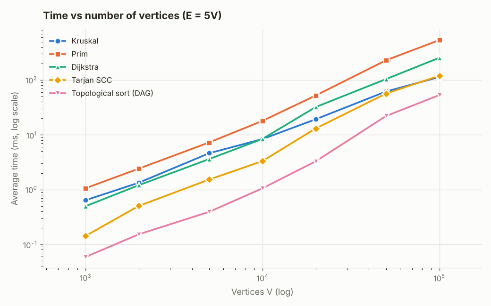
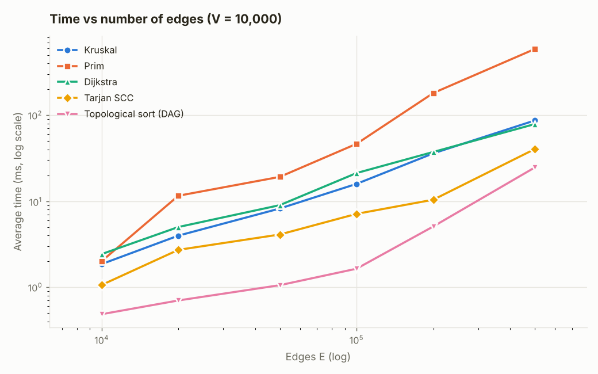
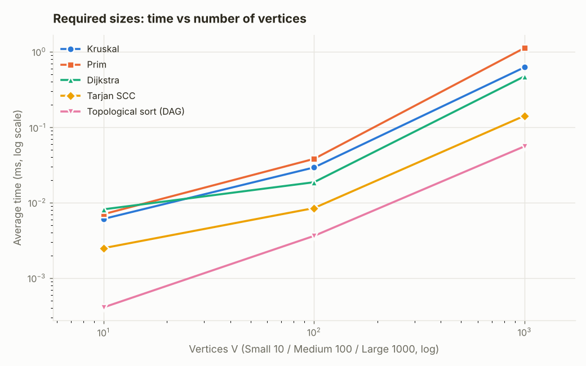
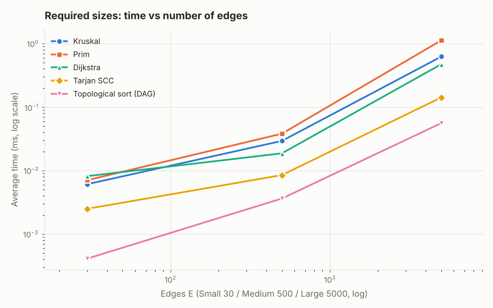
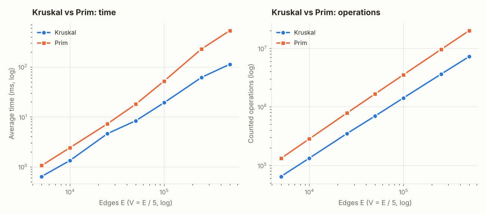
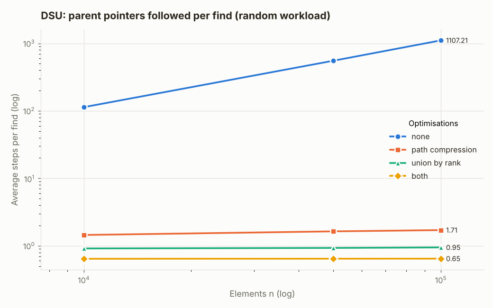

# Assignment 3 — Smart City Infrastructure and Route Planning

**Course:** Design and Analysis of Algorithms  
**Author:** Arsen Kuanov  
**Language:** Java 17+ (no external libraries); plots made with Python + matplotlib

A Java application that models a city as a graph and uses it to

1. **plan infrastructure:** the cheapest set of roads that connects every district (Minimum Spanning Tree, with Kruskal + DSU and Prim);
2. **analyse connectivity:** strongly connected components of one-way streets (Tarjan) and a valid start-up order of dependent services (topological sort);
3. **plan routes:** shortest distances and paths from one district to all others (Dijkstra).

Every algorithm is instrumented with operation counters, benchmarked on reproducible random graphs and checked by an automated test suite.

---

## Table of contents

1. [Overview](#1-overview)
2. [How to build and run](#2-how-to-build-and-run)
3. [Implementation](#3-implementation)
4. [Complexity analysis](#4-complexity-analysis)
5. [Experimental setup](#5-experimental-setup)
6. [Results](#6-results)
7. [Comparison and discussion](#7-comparison-and-discussion)
8. [Testing](#8-testing)
9. [Conclusion](#9-conclusion)

---

## 1. Overview

### The model

| City concept | Graph concept |
|---|---|
| District / location | vertex `0 .. V-1` |
| Road (two-way) | undirected edge |
| One-way street, or "service A must start before service B" | directed edge |
| Construction cost (MST) or travel distance (Dijkstra) | integer edge weight |

### Graph representation

`graph.Graph` is an **adjacency list**: `List<List<Edge>>`, plus a flat list of all edges.

- `adj(u)` returns the outgoing edges of `u`. Every stored `Edge` in `adj(u)` has `from() == u`, so every algorithm walks neighbours the same way (`e.to()`) for directed and undirected graphs.
- For an **undirected** graph a road `u–v` is stored in `adj(u)` *and* (as `v→u`) in `adj(v)`, but only once in `edges()`. Kruskal reads `edges()`; Prim, Tarjan, Kahn and Dijkstra read `adj()`.
- Memory is Θ(V + E). An adjacency list fits the task: city graphs are sparse (each district has a handful of roads), and all required algorithms only need "iterate over the neighbours of u", which costs O(deg u) here and O(V) in an adjacency matrix.

### Project structure

```
assignment-3/
├── src/
│   ├── graph/          Edge, Graph (adjacency list), GraphGenerator (seeded generators)
│   ├── dsu/            DisjointSetUnion (path compression + union by rank, both switchable)
│   ├── mst/            KruskalMST, PrimMST, MSTResult
│   ├── connectivity/   TopologicalSort (Kahn + cycle finder), TarjanSCC (+ condensation)
│   ├── shortestpath/   Dijkstra, BellmanFord (reference), ShortestPaths (result)
│   ├── experiments/    BenchmarkRunner (all measurements → results/tables)
│   └── app/            SmartCityDemo (readable example city)
├── test/tests/         AllTests (27 test groups, no external framework needed)
├── scripts/            plot_results.py (results/tables → results/plots)
├── results/
│   ├── tables/         benchmark.*, scaling_vertices.*, scaling_edges.*, dsu.*  (CSV + Markdown)
│   └── plots/          PNG plots used in this report
├── run.sh / run.bat    build, test, demo, benchmark, plots
└── README.md           this report
```

---

## 2. How to build and run

Only a JDK (17 or newer) is required. Python 3 + matplotlib are needed only to redraw the plots.

```bash
./run.sh test     # compile + run the test suite
./run.sh demo     # compile + run the smart-city example
./run.sh bench    # compile + run all experiments (~1.5 min), writes results/tables/
./run.sh plots    # redraw results/plots/ from results/tables/
./run.sh all      # everything above
```

On Windows use `run.bat test`, `run.bat demo`, etc. Manual commands:

```bash
javac --release 17 -d out $(find src -name "*.java")
javac --release 17 -cp out -d out-test $(find test -name "*.java")
java -cp out:out-test tests.AllTests            # use ; instead of : on Windows
java -cp out app.SmartCityDemo
java -Xms1g -Xmx2g -cp out experiments.BenchmarkRunner results/tables
python3 scripts/plot_results.py
```

In IntelliJ IDEA: open the folder, mark `src` as *Sources Root* and `test` as *Test Sources Root*, then run `SmartCityDemo`, `AllTests` or `BenchmarkRunner`.

### Demo output (`SmartCityDemo`)

```
=== Task 1. Road construction (MST), weights = construction cost ===
Kruskal: total cost 33, roads [Riverside-Green Hills(2), Central Station-University(3), Old Town-Central Station(4), Tech Park-Industrial Zone(4), University-Tech Park(5), University-Riverside(6), Tech Park-Airport(9)]
Prim: total cost 33, roads [Old Town-Central Station(4), Central Station-University(3), University-Tech Park(5), Tech Park-Industrial Zone(4), University-Riverside(6), Riverside-Green Hills(2), Tech Park-Airport(9)]
Same total cost: true
Disconnected city (two islands): Kruskal: weight=8, edges=2, connected=false (components=2)

=== Task 2. One-way streets (strongly connected components) ===
Number of SCCs: 3
  [Riverside, Industrial Zone, Green Hills]
  [Tech Park, Airport]
  [Old Town, Central Station, University]
Condensation graph is a DAG: true, component order: [2, 1, 0]

=== Task 2. Service start-up order (topological sort) ===
DAG -> start order: Power grid -> Water pumps -> Traffic lights -> Data center -> Metro -> Hospitals
After adding Hospitals -> Power grid: isDag=false, cycle: Power grid -> Water pumps -> Hospitals -> Power grid

=== Task 3. Route planning from Central Station (Dijkstra), weights = km ===
  Old Town           3 km  via [Central Station, Old Town]
  Central Station    0 km  via [Central Station]
  University         2 km  via [Central Station, University]
  Tech Park          7 km  via [Central Station, University, Riverside, Tech Park]
  Airport           12 km  via [Central Station, University, Riverside, Tech Park, Airport]
  Riverside          6 km  via [Central Station, University, Riverside]
  Industrial Zone   14 km  via [Central Station, University, Riverside, Industrial Zone]
  Green Hills      unreachable

=== Why Dijkstra fails with negative weights ===
  vertex 1: Dijkstra=2, Bellman-Ford=1
  vertex 2: Dijkstra=5, Bellman-Ford=5
  vertex 3: Dijkstra=3, Bellman-Ford=2
  Dijkstra.run(...) rejects the graph: Dijkstra requires non-negative edge weights
```

---

## 3. Implementation

### 3.1 Disjoint Set Union — `dsu.DisjointSetUnion`

- Arrays `parent[]` and `rank[]`; initially every element is its own root.
- **`find(x)`** — walks up to the root, then a second loop re-points every node on that path directly at the root (**path compression**). The loop is iterative, so long chains cannot overflow the stack.
- **`union(a, b)`** — finds both roots; if different, the root of smaller rank is attached under the root of larger rank; equal ranks → rank of the new root grows by one (**union by rank**). Returns `true` only if a merge happened, which is exactly what Kruskal needs.
- `components()` is kept up to date, so connectivity is answered in O(1).
- Both optimisations can be switched off with `new DisjointSetUnion(n, pathCompression, unionByRank)`. The experiments use this to measure each optimisation separately (§6.4).
- Counters: `findCalls`, `unionCalls`, `successfulUnions`, `parentSteps` (number of parent pointers followed — the real cost of `find`).

### 3.2 Kruskal — `mst.KruskalMST`

1. Copy `edges()` to an array and sort by weight (`Arrays.sort` = stable TimSort, through a comparator that counts comparisons).
2. Scan edges in increasing weight; `dsu.union(u, v)` is `true` exactly when the edge connects two different components → add it to the tree.
3. **Early exit** as soon as the tree has V − 1 edges (on the Large graph only 3,443 of 5,000 edges are examined).
4. **Connectivity:** after the scan `dsu.components()` is the number of connected components. If it is > 1 the result is a minimum spanning *forest* and `isConnected()` is `false`.

### 3.3 Prim — `mst.PrimMST`

"Lazy" Prim with `java.util.PriorityQueue` (a binary heap) of edges:

1. Mark the start vertex, push all its edges to unmarked vertices.
2. Poll the lightest edge; if its far end is already in the tree it is **stale** and skipped, otherwise add the edge and push the new vertex's edges.
3. When the heap empties but unvisited vertices remain, the graph is disconnected: Prim restarts from the next unvisited vertex and counts components. So both algorithms return the same minimum spanning forest weight and the same `components()` on any undirected graph.

Lazy Prim was chosen over the "eager" (decrease-key) version because Java's `PriorityQueue` has no decrease-key; the cost is that the heap can hold up to E entries instead of V.

### 3.4 Topological sort — `connectivity.TopologicalSort`

- **Kahn's algorithm:** compute in-degrees, queue every vertex with in-degree 0, repeatedly remove one and decrement the in-degree of its successors.
- If all V vertices are removed, the removal order is a valid topological order (`isDag() == true`).
- If fewer than V are removed, the rest lie on or behind a cycle → **no topological order exists**. In that case an iterative white/grey/black **DFS** finds a concrete cycle (a grey→grey edge) and rebuilds it from parent pointers, e.g. `Power grid -> Water pumps -> Hospitals -> Power grid`. Reporting the actual cycle is more useful to a planner than just "impossible".
- `isValidOrder(g, order)` checks that every edge goes forward in the order (used by tests).

### 3.5 Strongly connected components — `connectivity.TarjanSCC`

Tarjan's algorithm (one DFS):

- each vertex gets a discovery `index` and a `low` value = smallest index reachable from its DFS subtree using at most one edge back into the current stack;
- when a vertex finishes with `low == index`, it is the root of an SCC and all vertices above it on the SCC stack are popped into one component.

Design decisions:

- **Iterative DFS** with an explicit call stack and a "next edge" pointer per vertex. A recursive version would overflow Java's default stack on long paths; the tests run it on a 100,000-vertex path.
- Tarjan instead of Kosaraju: one DFS instead of two and no reversed graph to build (saves Θ(V + E) memory).
- `condensation(g, scc)` builds the component graph (always a DAG); the demo topologically sorts it, connecting Task 2's two parts.

### 3.6 Dijkstra — `shortestpath.Dijkstra`

- Binary heap (`PriorityQueue<long[]{distance, vertex}>`) with **lazy deletion**: an improved distance pushes a new entry; outdated entries are skipped when polled (`stalePolls`).
- Each vertex is **settled** exactly once (when first polled) and is never relaxed again. This is the classical algorithm, and it is the property that breaks with negative weights.
- `run()` **rejects negative weights** with an exception. `runWithoutValidation()` exists only to demonstrate the wrong answer.
- **Unreachable vertices** keep distance `ShortestPaths.INFINITY`; `isReachable(v)` is `false` and `pathTo(v)` is empty. Paths are rebuilt from `prev[]`.
- Distances are `long` so sums of `int` weights cannot overflow.
- `BellmanFord` (O(V·E), handles negative weights, detects negative cycles) is included as a **reference implementation** for the tests and for the counterexample.

#### Why Dijkstra is unsuitable for negative edge weights

Dijkstra is greedy. When it polls vertex *u* with the smallest tentative distance *d(u)*, it declares *d(u)* final. The proof: any other path to *u* must leave the settled set through some vertex *x* with *d(x) ≥ d(u)*, and the remaining edges can only **add** non-negative length, so that path cannot be shorter. With a negative edge the remaining part of the path can make it *shorter*, so the "final" distance can be wrong, and every vertex settled from it inherits the error.

Counterexample (from the demo): edges `s→a (2)`, `s→b (5)`, `b→a (−4)`, `a→c (1)`.

| Step | Dijkstra does | Problem |
|---|---|---|
| 1 | settles `s = 0`; tentative `a = 2`, `b = 5` | |
| 2 | settles `a = 2` (smallest), then `c = 3` | `a` is now "final" |
| 3 | settles `b = 5`; edge `b→a` would give `a = 1`, but `a` is already settled | true distances: `a = 1`, `c = 2` |

Dijkstra returns `a = 2, c = 3`; Bellman-Ford returns `a = 1, c = 2`. With a negative **cycle**, shortest paths are not even defined. For negative weights use **Bellman-Ford** (O(V·E)), or **Johnson's algorithm** (re-weighting + Dijkstra) for all pairs.

### 3.7 Operation counting

Counters are plain `long` fields/locals (no maps or reflection in hot loops), so the instrumentation overhead is small and the same for all runs. Every result exposes `operations()` with a `total` = sum of the main counters:

| Algorithm | Counted operations |
|---|---|
| Kruskal | sort comparisons, edges examined, DSU find calls, union calls, parent steps |
| Prim | heap comparisons, edges examined, heap inserts, heap polls, stale edges |
| Tarjan SCC | vertices visited, edges examined |
| Topological sort | vertex removals, edges examined (Kahn + cycle-finding DFS) |
| Dijkstra | heap comparisons, edges examined, successful relaxations, heap pushes, heap polls, stale polls |

---

## 4. Complexity analysis

**Assumptions:** adjacency-list representation; `java.util.PriorityQueue` = binary heap (O(log n) insert/poll); comparison sort = TimSort, O(n log n); simple graphs, so E ≤ V² and therefore **log E ≤ 2 log V, i.e. O(log E) = O(log V)**. α(n) is the inverse Ackermann function (α(n) ≤ 4 for any n that fits in memory).

| Algorithm | Time | Extra space | What dominates |
|---|---|---|---|
| DSU `find` / `union` (rank + compression) | **O(α(n))** amortised; O(log n) worst case for a single call | O(n) | tree height |
| DSU, union by rank only | O(log n) | O(n) | height ≤ log₂ n |
| DSU, path compression only | O(log n) amortised | O(n) | |
| DSU, no optimisations | **O(n)** per call (chain) | O(n) | |
| Kruskal | **O(E log E) = O(E log V)** | O(V + E) | sorting the edges |
| Prim (lazy, binary heap) | **O(E log E) = O(E log V)** | O(V + E) (heap up to E) | heap operations |
| Topological sort (Kahn) | **O(V + E)** | O(V) | each vertex/edge once |
| Cycle detection (DFS) | O(V + E) | O(V) | |
| Tarjan SCC | **O(V + E)** | O(V) | one DFS |
| Dijkstra (binary heap, lazy) | **O((V + E) log V)** | O(V + E) (heap up to E) | heap operations |
| Bellman-Ford (reference) | O(V · E) | O(V) | V − 1 rounds over all edges |

### How V and E affect each algorithm

- **DSU.** Cost depends on the *height* of the trees. Union by rank bounds the height by log₂ n (a tree of rank r has ≥ 2ʳ nodes). Path compression flattens every path it walks, so later finds on that path take one step. Together: total O(m · α(n)) for m operations, effectively constant per operation. Without either, a sequence of unions can build a chain of height n − 1 and every find costs Θ(n).
- **Kruskal.** Sorting: Θ(E log E). Then ≤ E iterations with 2 finds each: O(E · α(V)). So E dominates through the sort; V only enters through log V and the DSU arrays. Doubling E (V fixed) roughly doubles the time; adding vertices at a fixed density changes the time through E.
- **Prim (lazy).** Every edge is examined twice (once from each endpoint, so 2E adjacency entries) and pushed at most once, and every push/poll costs O(log E). Total O(E log E). V adds the outer loop (O(V)). With an indexed heap and decrease-key it is O(E log V); with a Fibonacci heap O(E + V log V); with an adjacency matrix O(V²), which is best for very dense graphs.
- **Topological sort.** Each vertex is enqueued/removed once (O(V)), each edge decrements one in-degree once (O(E)). Linear in both. For a cyclic graph Kahn stops early, and the cycle DFS is again O(V + E) in the worst case.
- **Tarjan SCC.** Each vertex is pushed/popped once on each stack and each edge is examined exactly once: Θ(V + E). Grows linearly with both; the number or size of components does not change the asymptotics.
- **Dijkstra.** Each vertex is settled once (V polls that do work), each edge is relaxed at most once (≤ E pushes), and each heap operation costs O(log E) = O(log V): O((V + E) log V). In a connected graph E ≥ V − 1, so this is O(E log V). Only vertices **reachable** from the source cost anything, so on directed graphs the effective V and E are those of the reachable part.

---

## 5. Experimental setup

### Machine and JVM

| | |
|---|---|
| CPU | Intel Xeon @ 2.80 GHz, 2 vCPUs (cloud Linux container) |
| RAM | 8 GB |
| JVM | OpenJDK 21.0.12, `-Xms1g -Xmx2g`, default G1 GC |
| Code | compiled with `javac --release 17` |

Absolute times depend on the machine; the shapes of the curves and the operation counts do not (operation counts are fully deterministic).

### Graph configurations

Required configurations:

| Name | V | E |
|---|---:|---:|
| Small | 10 | 30 |
| Medium | 100 | 500 |
| Large | 1,000 | 5,000 |

Additional scaling series (for smoother plots and for testing the theory over two orders of magnitude):

- **vertices series:** V = 1k, 2k, 5k, 10k, 20k, 50k, 100k with E = 5V;
- **edges series:** V = 10,000 fixed, E = 10k, 20k, 50k, 100k, 200k, 500k.

### Graph generation (`graph.GraphGenerator`)

All generators use `java.util.Random` with a **fixed seed**: `seed = 2026 + 31·V + E` (directed graph: seed + 1, DAG: seed + 2), so every run of the benchmark rebuilds exactly the same graphs. All graphs are simple (no self-loops, no parallel edges); weights are uniform integers in [1, 100], so **duplicate weights are frequent**.

| Generator | Used for | How edges are generated | Cycles? |
|---|---|---|---|
| `connectedUndirected(V, E)` | Kruskal, Prim, Dijkstra | Shuffle vertices; connect `perm[i]` to a random earlier `perm[j]` → random spanning tree (V − 1 edges), so the graph is **guaranteed connected**. Then add random distinct non-tree pairs until E edges. | (undirected) |
| `randomDirected(V, E)` | SCC, topological sort (cyclic case), Dijkstra on one-way streets | E distinct ordered pairs (u, v), u ≠ v, chosen uniformly. | **Yes.** Every generated configuration contains cycles; the topological sort detects them in all cases (reported cycle lengths: 7, 8, 20 for Small/Medium/Large). |
| `randomDag(V, E)` | SCC, topological sort (DAG case) | A hidden random permutation of the vertices; each edge goes from an earlier to a later position. | **No**, by construction (verified by the tests and by Kahn's algorithm). |

### Measurement procedure (`experiments.BenchmarkRunner`)

1. **Global JIT warm-up:** every algorithm runs 2,000 times on a 500-vertex graph before any measurement. Without this the first (small) graphs were measured in the interpreter / partially compiled code; for example Kruskal's sort only reaches its steady speed after ~1,000 runs.
2. For every (algorithm, graph): `System.gc()`, then unmeasured warm-up runs (≥ 3 runs and ≥ 100 ms).
3. **5 repetitions**, each timed with `System.nanoTime()`. One run on a 10-vertex graph takes ≈ 1–10 µs, which is close to the timer's jitter, so each repetition executes the algorithm *k* times back-to-back and records time / *k*. *k* is chosen so a repetition lasts ≥ 10 ms (*k* is in column `batch_k` of the CSV; *k* = 1 for big graphs).
4. The table reports the **mean of the 5 repetitions** ± standard deviation. Graph generation is never timed.
5. Operation counts are taken from the last run (they are identical in every run).

Raw data, including all 5 individual times per row: [`results/tables/benchmark.csv`](results/tables/benchmark.csv), [`scaling_vertices.csv`](results/tables/scaling_vertices.csv), [`scaling_edges.csv`](results/tables/scaling_edges.csv), [`dsu.csv`](results/tables/dsu.csv).

---

## 6. Results

Full tables with all counters: [`results/tables/benchmark.md`](results/tables/benchmark.md).

### 6.1 Task 1 — MST: Kruskal vs Prim (required sizes)

| Size | V | E | Kruskal time (µs) | Prim time (µs) | Kruskal ops | Prim ops | MST weight (K / P) |
|---|---:|---:|---:|---:|---:|---:|---|
| Small | 10 | 30 | 6.10 ± 0.82 | 7.05 ± 0.19 | 147 | 322 | 82 / 82 |
| Medium | 100 | 500 | 29.33 ± 4.05 | 38.12 ± 0.33 | 4,704 | 9,678 | 1189 / 1189 |
| Large | 1000 | 5000 | 623.97 ± 7.30 | 1,125.24 ± 58.82 | 64,357 | 131,020 | 11846 / 11846 |

Operation breakdown:

| Size | Kruskal: sort comparisons | edges examined | find | union | parent steps | Prim: heap comparisons | edges examined | heap inserts | heap polls | stale edges |
|---|---:|---:|---:|---:|---:|---:|---:|---:|---:|---:|
| Small | 111 | 9 | 18 | 9 | 2 | 202 | 60 | 30 | 30 | 21 |
| Medium | 3,836 | 217 | 434 | 217 | 351 | 7,678 | 1,000 | 500 | 500 | 401 |
| Large | 50,585 | 3,443 | 6,886 | 3,443 | 6,391 | 111,020 | 10,000 | 5,000 | 5,000 | 4,001 |

All generated graphs are connected (`connected=true`), and **Kruskal and Prim give the same total weight** on every graph.

### 6.2 Task 2 — SCC and topological ordering (required sizes)

| Size | Algorithm | Graph | Time (µs) | Vertices visited / removed | Edges examined | Result |
|---|---|---|---:|---:|---:|---|
| Small | Tarjan SCC | directed random | 2.50 ± 0.11 | 10 | 30 | SCCs=1, largest=10 |
| Small | Tarjan SCC | DAG | 4.03 ± 1.09 | 10 | 30 | SCCs=10, largest=1 |
| Small | Topological sort | DAG | 0.41 ± 0.03 | 10 | 60 | DAG, order of 10 vertices |
| Small | Topological sort | directed random | 0.41 ± 0.04 | 0 | 37 | cycle of length 7 |
| Medium | Tarjan SCC | directed random | 8.49 ± 0.16 | 100 | 500 | SCCs=2, largest=99 |
| Medium | Tarjan SCC | DAG | 10.42 ± 0.57 | 100 | 500 | SCCs=100, largest=1 |
| Medium | Topological sort | DAG | 3.63 ± 0.13 | 100 | 1,000 | DAG, order of 100 vertices |
| Medium | Topological sort | directed random | 1.26 ± 0.06 | 0 | 508 | cycle of length 8 |
| Large | Tarjan SCC | directed random | 141.99 ± 1.26 | 1,000 | 5,000 | SCCs=14, largest=987 |
| Large | Tarjan SCC | DAG | 71.79 ± 1.40 | 1,000 | 5,000 | SCCs=1000, largest=1 |
| Large | Topological sort | DAG | 55.92 ± 15.71 | 1,000 | 10,000 | DAG, order of 1000 vertices |
| Large | Topological sort | directed random | 10.53 ± 0.30 | 7 | 5,060 | cycle of length 20 |

(For the topological sort on a DAG, "edges examined" counts each edge twice: once for the in-degree pass and once when its source is removed.)

### 6.3 Task 3 — Dijkstra (required sizes, source = vertex 0)

| Size | Graph | Time (µs) | Heap comparisons | Edges examined | Relaxations | Heap pushes | Heap polls (stale) | Reachable |
|---|---|---:|---:|---:|---:|---:|---:|---|
| Small | undirected connected | 8.17 ± 4.47 | 76 | 60 | 16 | 17 | 17 (7) | 10/10 |
| Small | directed random | 0.92 ± 0.03 | 42 | 30 | 12 | 13 | 13 (3) | 10/10 |
| Medium | undirected connected | 18.69 ± 3.08 | 2,385 | 1,000 | 202 | 203 | 203 (103) | 100/100 |
| Medium | directed random | 12.37 ± 3.18 | 1,362 | 500 | 138 | 139 | 139 (39) | 100/100 |
| Large | undirected connected | 473.61 ± 5.04 | 35,395 | 10,000 | 1,927 | 1,928 | 1,928 (928) | 1000/1000 |
| Large | directed random | 288.91 ± 27.25 | 24,240 | 4,967 | 1,444 | 1,445 | 1,445 (452) | 993/1000 |

On the Large one-way network 7 districts are **unreachable** from the source (nothing leads into them); they are reported with distance ∞ and an empty path.

### 6.4 DSU: effect of path compression and union by rank

Full table: [`results/tables/dsu.md`](results/tables/dsu.md). "Parent steps" = parent pointers followed by all `find` calls.

| Workload | n | none | path compression | union by rank | both |
|---|---:|---:|---:|---:|---:|
| chain: `union(i, i+1)` then `find(i)` ∀i — steps per find | 20,000 | **3,333.28** | 0.67 | 0.67 | 0.67 |
| ↳ time (ms) | 20,000 | **465.32** | 0.22 | 0.15 | 0.16 |
| random unions + finds — steps per find | 10,000 | 113.36 | 1.45 | 0.91 | 0.64 |
| ↳ | 50,000 | 552.77 | 1.64 | 0.93 | 0.65 |
| ↳ | 100,000 | **1,107.21** | 1.71 | 0.95 | **0.65** |
| ↳ time (ms) | 100,000 | **2,308.83** | 8.94 | 10.65 | **7.72** |
| inside Kruskal (V=10,000, E=50,000) — steps per find | 10,000 | 892.65 | 2.08 | 1.84 | 0.95 |
| ↳ Kruskal time (ms) | 10,000 | **249.86** | 16.99 | 16.26 | **12.74** |

### 6.5 Scaling: time vs number of vertices and edges

Average time in **ms** (E = 5V for the first table, V = 10,000 for the second). Full tables: [`scaling_vertices.md`](results/tables/scaling_vertices.md), [`scaling_edges.md`](results/tables/scaling_edges.md).

| V | E | Kruskal | Prim | Tarjan SCC | Topological sort (DAG) | Dijkstra |
|---:|---:|---:|---:|---:|---:|---:|
| 1,000 | 5,000 | 0.64 | 1.06 | 0.14 | 0.06 | 0.50 |
| 2,000 | 10,000 | 1.33 | 2.41 | 0.50 | 0.15 | 1.20 |
| 5,000 | 25,000 | 4.61 | 7.25 | 1.52 | 0.39 | 3.61 |
| 10,000 | 50,000 | 8.35 | 17.93 | 3.31 | 1.05 | 8.41 |
| 20,000 | 100,000 | 19.21 | 52.16 | 13.05 | 3.28 | 32.06 |
| 50,000 | 250,000 | 61.74 | 229.58 | 56.56 | 22.03 | 104.04 |
| 100,000 | 500,000 | 113.38 | 535.08 | 119.41 | 53.08 | 254.95 |

| V | E | Kruskal | Prim | Tarjan SCC | Topological sort (DAG) | Dijkstra |
|---:|---:|---:|---:|---:|---:|---:|
| 10,000 | 10,000 | 1.86 | 2.01 | 1.06 | 0.49 | 2.43 |
| 10,000 | 20,000 | 3.98 | 11.59 | 2.72 | 0.70 | 5.02 |
| 10,000 | 50,000 | 8.24 | 19.20 | 4.11 | 1.06 | 9.01 |
| 10,000 | 100,000 | 15.92 | 46.49 | 7.14 | 1.64 | 21.27 |
| 10,000 | 200,000 | 36.05 | 181.07 | 10.43 | 5.09 | 37.41 |
| 10,000 | 500,000 | 86.86 | 587.80 | 40.40 | 24.70 | 78.89 |

(Tarjan SCC is measured on the random directed graph, Dijkstra on the connected undirected graph.)

### 6.6 Plots

**Execution time vs number of vertices** (E = 5V, log–log):



**Execution time vs number of edges** (V = 10,000, log–log):



**The three required configurations** (Small / Medium / Large), time vs V and time vs E:




**Kruskal vs Prim** — time and counted operations:



**DSU optimisations** — average parent steps per `find`:



---

## 7. Comparison and discussion

### 7.1 Kruskal vs Prim

- **Correctness:** identical MST weight on every benchmark graph and on 300+ random test graphs, even though the chosen edge sets can differ (graphs have many equal weights, so many MSTs exist; see the demo, where the two algorithms list the roads in different orders).
- **Operation counts follow theory exactly.** Kruskal's total stays at **0.87–1.29 · E log₂V** and Prim's at **2.42–2.63 · E log₂V** over the whole range V = 1k…100k: both are Θ(E log V), and Prim's constant is ~2–2.8× larger. Reasons visible in the breakdown: Prim examines every edge **twice** (2E adjacency entries), pushes up to E edges into a heap where each push/poll costs ~log E comparisons, and **80 % of polled edges are stale** (4,001 of 5,000 on Large). Kruskal sorts once (TimSort exploits runs and does fewer comparisons than a heap), and stops early once V − 1 edges are taken (3,443 of 5,000 edges examined).
- **Time.** On the Small graph they are equal within noise (6.1 vs 7.1 µs), because fixed overhead dominates. From Medium on, **Kruskal is faster**: 1.3× (Medium), 1.8× (Large), up to **4.7×** at V = 100k. The time gap grows faster than the operation gap (2.0× → 2.8×). That extra part is **memory locality**: Kruskal sorts one contiguous array, while Prim's heap is a large array of references to `Edge` objects scattered over the heap, and every sift-down touches unrelated cache lines. Once the heap no longer fits in cache (≈ V ≥ 20k), Prim's time per E·log₂V unit rises from 21 to 64 ns, while Kruskal's stays at ≈ 12–16 ns.
- **When Prim would win:** dense graphs (E ≈ V²) with an adjacency-matrix O(V²) Prim, or when edges arrive as adjacency lists and sorting all of them up front is not possible. For sparse road networks (E = 5V), Kruskal + DSU is the better choice.

### 7.2 DSU optimisations

- **No optimisation** is quadratic in the worst case: the chain workload costs exactly n(n − 1)/2 parent steps (199,990,000 for n = 20,000, i.e. 3,333 per find, 465 ms). On random operations the cost per find grows **linearly with n** (113 → 553 → 1,107 steps as n goes 10k → 50k → 100k).
- **Path compression alone:** the first `find` on a long path pays for it once, and every later find on that path takes one step. Steps per find stay at 1.45 → 1.71 (slow logarithmic-like growth, matching the O(log n) amortised bound).
- **Union by rank alone:** trees can never get taller than log₂ n; measured ≈ 0.91–0.95 steps per find, almost flat.
- **Both:** ≈ **0.65 steps per find for every n**, i.e. effectively constant. This matches O(α(n)).
- **Inside Kruskal** (V = 10,000) the optimised DSU is **19.6× faster** (12.7 ms vs 249.9 ms) and makes 937× fewer parent steps. On the 1,000-vertex graph the difference is only 3.5× because trees are still shallow, so the optimisations matter more as the graph grows.

### 7.3 SCC (Tarjan)

- The operation count is **exactly V + E** for every graph (each vertex visited once, each edge examined once), confirming Θ(V + E).
- Time grows close to linearly while the graph fits in cache: 0.14 → 0.50 → 1.52 → 3.31 ms for V = 1k → 10k (≈ 24 → 55 ns per vertex+edge). For larger graphs the time per element rises to ≈ 110 ns (V = 20k) and ≈ 190–200 ns (V = 50k–100k): the DFS jumps between random vertices, so almost every step is a cache miss. The algorithm is still linear; the constant changed. The **time vs E** series (V fixed) is close to a straight line, because V stays the same and cache behaviour changes less.
- **Structure of random one-way networks:** with E = 5V almost everything forms **one giant SCC** (987 of 1,000 vertices; 98,620 of 100,000) plus a few singletons with no in- or out-edges. On a DAG every vertex is its own SCC. The random cyclic graph is slower than the DAG of the same size (142 vs 72 µs on Large) most likely because inside a giant SCC the DFS goes very deep, the stacks hold most vertices at once and the walk jumps across the whole graph.

### 7.4 Topological ordering: DAG vs cyclic graphs

- On DAGs Kahn's algorithm removes all V vertices and examines each edge twice (in-degree pass + removal): **V + 2E operations**, linear (0.06 → 53 ms from 1k to 100k vertices).
- On the random cyclic graphs almost no vertex has in-degree 0 (0 on Small/Medium, 7 on Large), so Kahn stops after the in-degree pass and the cycle-finding DFS finds a cycle after a few steps. That is why the cyclic case is **cheaper** than the DAG case (10.5 µs vs 55.9 µs on Large). Topological sorting fails fast on cyclic graphs, and the reported cycle tells the planner which dependency to remove.
- Every returned order was checked for validity (all edges go forward) in the tests; every cyclic graph was detected.

### 7.5 Dijkstra

- **Operation counts:** relaxations ≈ 1.6–2.0 V on the undirected graphs, heap pushes = relaxations + 1, and stale polls = pushes − (number of reachable vertices). This is the lazy-deletion overhead (~48 % of polls on Large undirected). The total grows like (V + E) log V: from Medium to Large, (V + E) log V grows by a factor of 15; heap comparisons grow 14.8× (2,385 → 35,395).
- **Time** follows the same curve: 18.7 µs → 474 µs for Medium → Large, and 0.50 ms → 255 ms for V = 1k → 100k. The time per (V + E)·log₂V stays at 8–11 ns up to V = 10k and rises to ≈ 25 ns for the largest graphs (again the cache effect of a large heap).
- On the one-way (directed) graphs Dijkstra is faster than on the undirected graphs of the same size because each road is one adjacency entry, not two, and **only the reachable part is explored**. With E = V (sparse one-way network, first row of [`scaling_edges.md`](results/tables/scaling_edges.md)) the source reaches only a few vertices; all the others are correctly reported as unreachable.
- Negative weights are rejected (see §3.6 for why and for the counterexample).

### 7.6 Theory vs experiment — summary

| Algorithm | Theory | Experiment |
|---|---|---|
| DSU (both optimisations) | O(α(n)) amortised | 0.64–0.65 steps per find for n = 10k…100k (constant) |
| DSU (none) | O(n) per op | steps per find grow linearly with n; chain case exactly n(n−1)/2 |
| Kruskal | O(E log V) | ops / (E log₂V) = 0.87–1.29 (constant); time/(E log₂V) = 12–16 ns (constant) |
| Prim (lazy) | O(E log V) | ops / (E log₂V) = 2.42–2.63 (constant); time per op rises at large E (cache) |
| Tarjan SCC | O(V + E) | ops = V + E exactly; time linear up to cache limit |
| Topological sort | O(V + E) | ops = V + 2E on DAGs; early exit on cyclic graphs |
| Dijkstra | O((V + E) log V) | heap comparisons grow as (V + E) log V; time/((V+E) log₂V) = 8–25 ns |

**Operation counts match the asymptotic bounds closely in every case.** Wall-clock time matches them while the data fits in CPU caches. Beyond that, memory access patterns (contiguous arrays vs scattered objects) add a constant factor that the RAM model ignores. This is the main reason the observed Kruskal-vs-Prim gap is larger than the operation counts alone predict.

Limitations: one machine with 2 shared vCPUs; small-graph timings (≈ 1 µs) remain sensitive to noise even with batching (see the ± columns); the JIT may optimise differently on another JVM.

---

## 8. Testing

`test/tests/AllTests.java` is a self-contained test runner (no JUnit, so it runs with a bare JDK). `./run.sh test` prints `PASS`/`FAIL` for each group and exits with code 1 if anything fails.

```
27 passed, 0 failed
```

| Group | What is tested |
|---|---|
| **DSU** | union/find/connected/components on a small example; all 4 variants (with/without each optimisation) give identical answers on 2,000 random operations; chain test: naive DSU costs exactly n(n−1)/2 steps, optimised < 3n |
| **MST** | known graph (weight 14); **multiple valid MSTs** (K4 with equal weights, square with equal sides) → both are spanning trees of equal weight; **duplicate weights** → equal to brute force; **disconnected graph** (two components + 2 isolated vertices) → `isConnected() == false`, 4 components, forest weight 10; **single vertex** and empty graph; **300 random connected graphs: Kruskal = Prim = brute force** (brute force tries every subset of V−1 edges); 5 large graphs (1,000/5,000): Kruskal = Prim; result has V−1 edges and no cycle |
| **Topological sort** | small DAG → order valid; **graph with a cycle** → `isDag() == false`, no order, and the reported cycle is a real cycle in the graph; self-loop; single vertex; edgeless graph; **200 random DAGs → every order valid**; 200 random graphs with an added reverse edge → **every cycle detected** with a valid witness |
| **SCC** | known graph with 3 SCCs; DAG → V singleton SCCs; single vertex; 1,000-vertex ring → 1 SCC; **200 random digraphs compared with brute-force mutual reachability** (u, v in the same SCC ⇔ u reaches v and v reaches u); **every vertex belongs to exactly one SCC** (checked for every tested graph); 100,000-vertex path (no stack overflow); condensation is a DAG |
| **Dijkstra** | known distances and paths; **unreachable vertices** (∞ distance, empty path, reachable count); **single vertex**; zero-weight and duplicate-weight edges; **negative weights rejected**, and the counterexample gives the wrong answer without the check; **300 random graphs: Dijkstra = Bellman-Ford**, and every returned path's weight equals its distance |
| **Generators** | exact V and E for all three required sizes; undirected graphs are connected; DAGs are acyclic; same seed → identical graph |

The required checks map to these tests:

| Requirement | Verified by |
|---|---|
| Kruskal and Prim return the same MST weight on connected undirected graphs | `MST: Kruskal == Prim == brute force on 300 random graphs` (+ every benchmark graph) |
| Topological ordering is valid for every DAG | `Topo: random DAGs always valid ...`, `isValidOrder` |
| Cyclic graphs are identified | `Topo: cycle detected and reported`, `Topo: self-loop`, random cycle test |
| Every vertex belongs to exactly one SCC | `checkPartition` in all SCC tests |
| Dijkstra is correct for non-negative weights | `Dijkstra == Bellman-Ford on 300 random graphs`, known-graph test |

---

## 9. Conclusion

- **Infrastructure planning (MST):** both algorithms always return the same minimum cost and detect disconnected cities. For sparse road networks **Kruskal with an optimised DSU** is the better choice: about half the operations of lazy Prim, cache-friendly, and 1.3–4.7× faster in the experiments. **Prim** is preferable for dense graphs (O(V²) matrix version) or when the tree has to grow from a specific district.
- **DSU:** path compression and union by rank are essential. Without them a find can cost Θ(n) (3,333 steps per find at n = 20,000) and Kruskal becomes 20× slower; with both, a find costs ≈ 0.65 pointer steps at any size.
- **Connectivity:** **Tarjan's SCC** finds mutually reachable districts of a one-way network in a single linear pass. **Kahn's topological sort** gives a valid start-up order of services in linear time and fails fast with an explicit cycle when the dependencies are circular. The SCC condensation links the two: any directed network becomes a DAG of components that can be ordered.
- **Route planning:** **Dijkstra** with a binary heap scales as O((V + E) log V), handles unreachable districts, and is correct only for non-negative weights (travel distances and times). For negative weights use Bellman-Ford.
- **Theory vs practice:** counted operations match the asymptotic bounds closely; wall-clock times match until the data stops fitting in cache, after which memory layout (arrays vs object graphs) explains the remaining differences.
